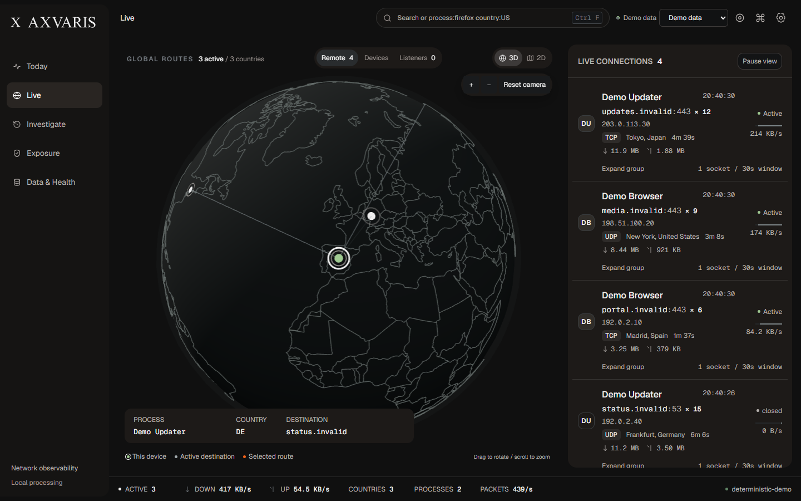

<picture>
  <source media="(prefers-color-scheme: dark)" srcset="apps/desktop/public/brand/axvaris-wordmark-light.svg">
  
</picture>

**Network observability. Local evidence.**

Axvaris is a desktop application for investigating the network activity of your computer. Follow connections, inspect the processes behind them, and reconstruct activity from locally stored evidence. No account, subscription, telemetry service or paid API is required.

[Architecture](ARCHITECTURE.md) · [Privacy](PRIVACY.md) · [Validation](docs/AXVARIS_VALIDATION.md) · [License](LICENSE)



## Investigation workspaces

- **Today:** activity summaries, changes and evidence drill-downs.
- **Live:** connections, local peers and listeners, with a synchronized map and contextual inspector.
- **Investigate:** paginated history, process instances, timelines and read-only `.sabi` investigation bundles.
- **Exposure:** listening sockets, interfaces and explainable local rules.
- **Data & Health:** capture capabilities, diagnostics, retention, privacy and external DNS imports.

Process attribution includes PID and process creation time when available. Unresolved attribution remains explicit. Provider clocks, provenance and loss reports accompany evidence; geographical coordinates are never invented.

Import CSV or JSON resolver logs to follow observed client addresses and queried domains over time. Imports preserve their source and remain distinct from local capture. A DNS query proves neither a connection nor the identity of a remote process. Start with the [CSV](apps/desktop/public/templates/dns-queries.csv) or [JSON](apps/desktop/public/templates/dns-queries.json) template.

## Capture support

| Platform | Baseline | Event capture | Limits |
|---|---|---|---|
| Windows | IP Helper socket snapshots | Optional ETW network and DNS events | Elevated event capture needs permission; polling can miss short-lived sockets. |
| Linux | INET_DIAG TCP/UDP, IPv4/IPv6 snapshots | Optional local Aya helper, installed separately | Active TCP attribution; UDP owners unknown. See the [Linux guide](linux.md) for permissions and limits. |

Axvaris observes the local machine. External devices are represented through imported DNS evidence; this release does not install remote agents. Optional local GeoIP databases provide approximate destination context. Reverse DNS is opt-in.

## Getting started

Download a platform package from [GitHub Releases](https://github.com/Hakaelll/axvaris/releases) when available. Historical Sabicheiro packages predate this redesign; check the release notes for the exact revision.

Run the reproducible browser preview:

```sh
pnpm install --frozen-lockfile
pnpm dev
```

The preview uses deterministic fixtures. Native capture and persistent DNS import require the desktop application:

```sh
pnpm --dir apps/desktop tauri dev
```

Building requires Rust, the pinned pnpm toolchain and the [Tauri platform prerequisites](https://v2.tauri.app/start/prerequisites/). Windows uses WebView2; Linux uses WebKitGTK.

```sh
pnpm check
pnpm lint
pnpm --dir apps/desktop tauri build
```

## Data and upgrades

Axvaris is the new public identity of Sabicheiro. The technical application identifier, existing data directory and `.sabi` format remain compatible. SQLite upgrades are transactional and retain a recoverable pre-migration backup. Review export redaction controls before sharing sensitive evidence.

English is the default; Spanish and saved language preferences remain available. Geist and Geist Mono are packaged locally. The interface supports keyboard navigation, visible focus, reduced motion and text scaling. See the [brand assets](docs/AXVARIS_BRAND.md).

## Engineering and validation

React and TypeScript provide the interface; Tauri and Rust coordinate native capture, evidence correlation and SQLite storage. Capture and rendering run independently. Histories are paginated, dense lists are virtualized, and live correlation caches are bounded.

The [validation record](docs/AXVARIS_VALIDATION.md) distinguishes automated checks from native acceptance work. Controlled Linux kernel fixtures have passed in Docker. Elevated Windows capture, installation lifecycle, assistive technologies and prolonged resource measurements still require their own evidence. A successful build alone does not establish those guarantees.

Contributions should include a reproducible problem, the smallest complete fix and relevant verification. See [CONTRIBUTING.md](CONTRIBUTING.md), [DEPENDENCIES.md](DEPENDENCIES.md) and [THIRD_PARTY_NOTICES.md](THIRD_PARTY_NOTICES.md).

Licensed under [MIT](LICENSE).
